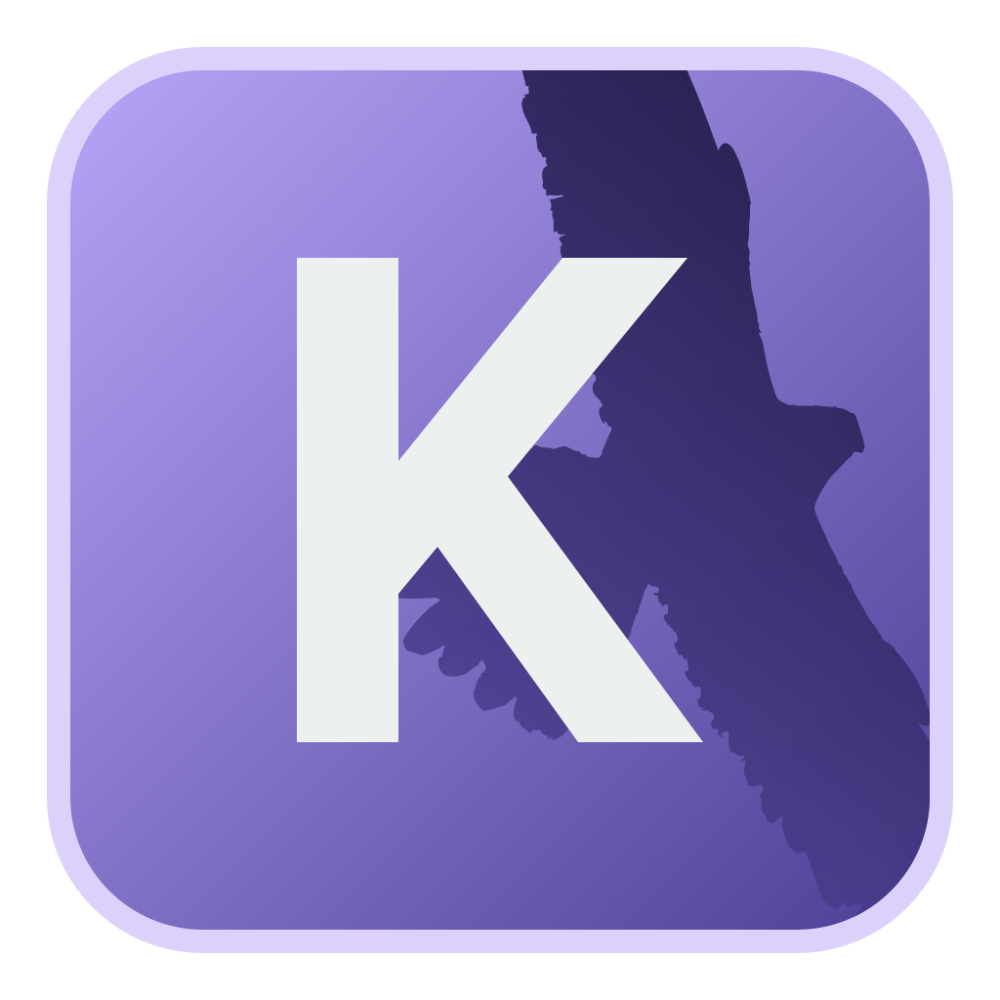

# Kestrel
**K**een-**E**yed **S**earch **T**rained on **R**eal **E**ncounters from **L**ichess

[](https://eande171.github.io/kestrel/play/)
[](https://lichess.org/@/KestrelChess)
[](https://lichess.org/@/KestrelChess)
[](https://github.com/eande171/kestrel/actions/workflows/pages.yml)
[](https://github.com/eande171/kestrel/actions/workflows/docker.yml)
[](LICENSE)

[Website and play page](https://eande171.github.io/kestrel/) · [Lichess bot](https://lichess.org/@/KestrelChess) · [Documentation](https://github.com/eande171/kestrel/wiki)


*A real one minute game on Lichess: Kestrel (Black) queens two passed pawns and mates bfiedler-bot.*

## Purpose
**Kestrel** is a chess engine built around a small neural network, about half a million parameters, trained on games and Stockfish evaluations from the Lichess open database. A short search on top of the network does the rest.

It started as a learning project and turned into a decent opponent: it plays rated games as a bot on Lichess, and the same engine runs in your browser on its own [website](https://eande171.github.io/kestrel/).

## Features
- **Small:** The network is about 2 MB on disk and runs in 8-bit integers once loaded. The whole play page downloads about 3 MB.
- **Plays in your Browser:** The Rust engine compiles to WebAssembly and runs in a Web Worker, so there's no server behind the play page.
- **Plays on Lichess:** As [KestrelChess](https://lichess.org/@/KestrelChess), it accepts challenges, finds its own games against other bots, thinks on its opponent's time and remembers how it beat each opponent before.
- **Learned from Games:** There's no chess knowledge coded into the evaluation. The network learned which moves to consider and who is winning from millions of positions.
- **Fast on a Normal CPU:** Hand-written int8 kernels for AVX-VNNI, AVX2 and WebAssembly SIMD evaluate a position in about 0.2 ms on a desktop.
- **Properly Tested:** Changes are kept only if they win matches against the previous version and do better on a suite of positions where Kestrel went wrong in real games.

# Getting Started
## Play It
Open the [play page](https://eande171.github.io/kestrel/play/) and pick a colour and a strength, or challenge [KestrelChess](https://lichess.org/@/KestrelChess) on Lichess.

## Run the Bot
The bot is published as a Docker image. With your bot account's token, a `bot.toml` (start from [`bot.example.toml`](bot.example.toml)) and an exported model:

```bash
cd docker
mkdir -p config secrets       # bot.toml, model.onnx and model.kstn go in config/, the token in secrets/lichess_token.txt
sudo chown -R 1000:1000 config secrets
docker compose up -d
```

Setting up a bot account, every config option, and running it on CasaOS are covered in the [wiki](https://github.com/eande171/kestrel/wiki/Lichess-Bot).

## Build From Source
You'll need Rust (stable) and, for training, Python 3.13 with PyTorch.

```powershell
cd engine
cargo build --release
cargo test --release
```

`.\scripts\build_web.ps1` builds the WebAssembly engine into `docs/play/`, and `.\scripts\train.ps1` starts or resumes a training run. The [wiki](https://github.com/eande171/kestrel/wiki) walks through preparing data, training, exporting and comparing models.

## Documentation
The [wiki](https://github.com/eande171/kestrel/wiki) covers the data pipeline, training, the engine and its search, the Lichess bot, the website, and the results of every experiment. The [website](https://eande171.github.io/kestrel/) explains how Kestrel works for everyone else.

## License
GNU AGPL v3. If you run a modified version, including as a bot or on a website, you must make your source available under the same license. The model weights in `docs/play/model.kstn` are released under the same terms.

Training data comes from the [Lichess open database](https://database.lichess.org/) (CC0). The kestrel in the logo is a silhouette by David García-Callejas from [PhyloPic](https://www.phylopic.org/images/9db60762-6b38-475e-a013-a9e7b71bc46a) (CC0). Thank you to both.
